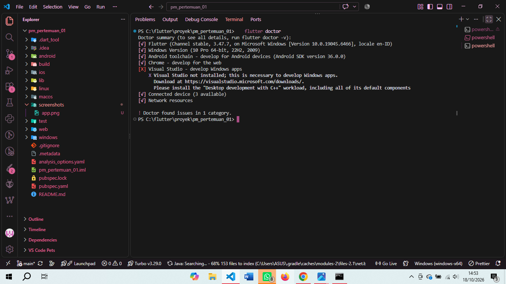
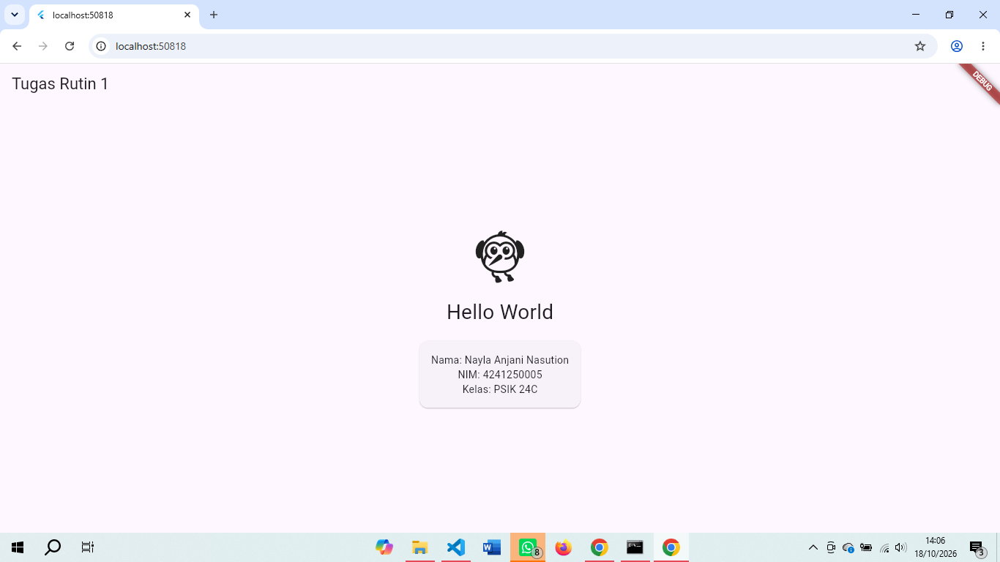

# pm-pertemuan-01-4241250005

Tugas Rutin 1 - Pemrograman Mobile

- Nama: Nayla Anjani Nasution
- NIM: 4241250005
- Kelas: PSIK 24C

Aplikasi Flutter sederhana yang menampilkan Hello World beserta nama, NIM, dan kelas. Widget tambahan yang dipakai: `Icon` dan `Card`.

## Versi Flutter

Output `flutter --version`:

```
Flutter 3.47.7 • channel stable • https://github.com/flutter/flutter.git
Framework • revision abaf9c5237 (10 days ago) • 2026-10-08 09:51:21 -0700
Engine • hash d8a2d6c768c334d53e16277f837970ffa1e2de81 (revision deb287481e) (10 days ago) • 2026-10-07 17:09:12.000Z
Tools • Dart 3.13.5 • DevTools 2.60.0
```

## Tangkapan Layar

Hasil `flutter doctor`:



Tampilan aplikasi:



## Kendala dan Solusi

**1. Nama repository diawali tanda minus**
Saat membuat repo di GitHub, nama repo saya tidak sengaja menjadi `-pm-pertemuan-01-4241250005`. Solusinya, saya buka Settings repo, lalu mengganti Repository name dengan menghapus tanda minus di depan dan klik Rename, sebelum melakukan push.

**2. Tampilan di Chrome masih aplikasi demo bawaan**
Setelah kode `main.dart` diganti, Chrome masih menampilkan aplikasi counter bawaan Flutter karena aplikasi sudah dijalankan sebelum kode diubah. Solusinya, saya tekan `R` (hot restart) di terminal, dan tampilan pun berubah sesuai kode terbaru.

## Pernyataan Penggunaan AI

Saya menggunakan Claude (AI) sebagai pemandu dalam proses setup: instalasi Flutter, pembuatan proyek, penggunaan Git dan GitHub, serta contoh kode awal untuk `main.dart` dan draf README. Semua langkah saya jalankan sendiri di laptop saya, dan hasilnya saya cek langsung.